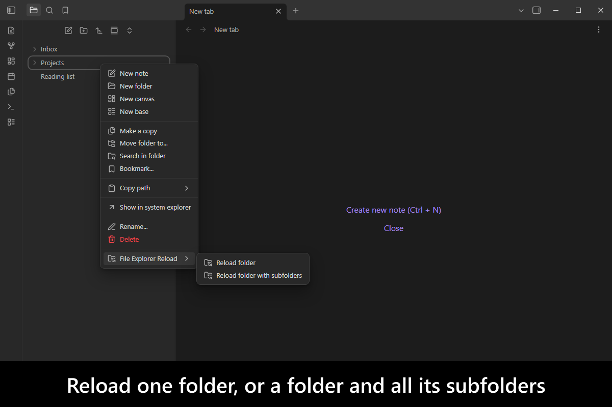

# File Explorer Reload

    

Copy, move or delete files outside [Obsidian](https://obsidian.md/) while it is open — from your file manager, a script, a sync client — and the File Explorer pane can fall behind what is actually on disk. It keeps listing files that are gone, and misses files that arrived.

The usual remedy is **Reload app without saving**, which discards your whole session to refresh one pane and is slow on a large vault. This plugin refreshes only the file list: the entire pane, a single folder, or a folder and everything beneath it.

<!-- markdownlint-disable MD033 -->

More screenshots

<!-- markdownlint-enable MD033 -->

## Demo vault

**The documentation is a demo vault.** The feature has a note that explains what it does and why you would want it, with a nested folder to refresh.

**[Start reading here](<./demo-vault/00 Start.md>)** — it is plain markdown, so it works on `GitHub` with nothing installed.

A copy of the vault ships with every release. You can access it via any of the following:

1. Running the **`File Explorer Reload`: Open demo vault** command.
2. Downloading `file-explorer-reload-demo-vault.zip` from the [Releases](https://github.com/mnaoumov/obsidian-file-explorer-reload/releases). It unzips into a single `file-explorer-reload-demo-vault-<version>` folder.
3. Browsing its source in [`demo-vault/`](./demo-vault/README.md) in this repository.

## What it does

- **Reload File Explorer** rebuilds the whole pane from disk, from the Command Palette. [01 Reload file explorer](<./demo-vault/01 Reload file explorer.md>)
- **Reload Folder** and **Reload Folder with Subfolders** do the same for one part of the tree, from the folder right-click menu — the first shallow, the second all the way down. [01 Reload file explorer](<./demo-vault/01 Reload file explorer.md>)

There is nothing to configure.

## See also

[My other Obsidian resources](https://mnaoumov.dev/obsidian/)

| Plugin | Features | How `File Explorer Reload` differs |
| --- | --- | --- |
| [`Auto Refresh Explorer`](https://community.obsidian.md/plugins/auto-refresh-explorer) | Periodic polling of configured folders; adds new synced files; desktop/mobile | Broader reconciliation: adds and removes files; any folder/vault on request |
| [`Rebuild Vault Index`](https://community.obsidian.md/plugins/rebuild-vault-index) | Indexes hidden folders; rebuilds metadata cache; reloads plugins | Different scope: reloads ordinary vault folders |
| [`Symlink Refresh Button`](https://github.com/camfung/obsidian-symlink-refresh-button) | Unlisted; explorer button renames symlink folders out/back to trigger reread | Same refresh goal; reads folders directly, symlinked or ordinary |
| [`Vault File Refresh`](https://community.obsidian.md/plugins/vault-file-refresh) | Periodic whole-vault reconciliation; new/changed files; on-demand scan | Alternative timing: only on request; folder or vault scope; removes missing files too |

Last searched for similar plugins on 2026-10-26.

## Installation

The plugin is available in [the official Community Plugins repository](https://community.obsidian.md/plugins/file-explorer-reload).

### Beta versions

To install the latest beta release of this plugin (regardless if it is available in [the official Community Plugins repository](https://community.obsidian.md) or not), follow these steps:

1. Ensure you have the [BRAT plugin](https://community.obsidian.md/plugins/obsidian42-brat) installed and enabled.
2. Click [Install via BRAT](https://intradeus.github.io/http-protocol-redirector?r=obsidian://brat?plugin=https://github.com/mnaoumov/obsidian-file-explorer-reload).
3. An Obsidian pop-up window should appear. In the window, click the `Add plugin` button once and wait a few seconds for the plugin to install.

## Debugging

By default, debug messages for this plugin (id: `file-explorer-reload`) are hidden.

If you need to enable them refer to the [documentation](https://mnaoumov.dev/obsidian-lib/guides/debugging/).

## Changelog

All notable changes to this project will be documented in the [CHANGELOG](./CHANGELOG.md).

## Contributing

Contributions are welcome — see [CONTRIBUTING](./CONTRIBUTING.md) to get set up.

## Support

<!-- markdownlint-disable MD033 -->

<!-- markdownlint-enable MD033 -->

### Filing an issue (for AI agents and humans)

Open issues through the [issue forms](https://github.com/mnaoumov/obsidian-file-explorer-reload/issues/new/choose), not as blank issues.

To report a bug from inside Obsidian, run the **`File Explorer Reload`: Report a bug** command. It opens the bug form with the plugin version, the Obsidian version and your operating system already filled in.

Filing from the CLI or the API (`gh issue create --body`, or an AI agent filing for you) skips the form, and `gh issue create --template` cannot load an issue form. In that case, open the matching form in [`.github/ISSUE_TEMPLATE/`](https://github.com/mnaoumov/obsidian-file-explorer-reload/tree/HEAD/.github/ISSUE_TEMPLATE), copy every field as a `### <label>` heading in the form's order, and fill in each one. Always state the plugin version, the Obsidian version and your operating system.

## License

© [Michael Naumov](https://github.com/mnaoumov/)
