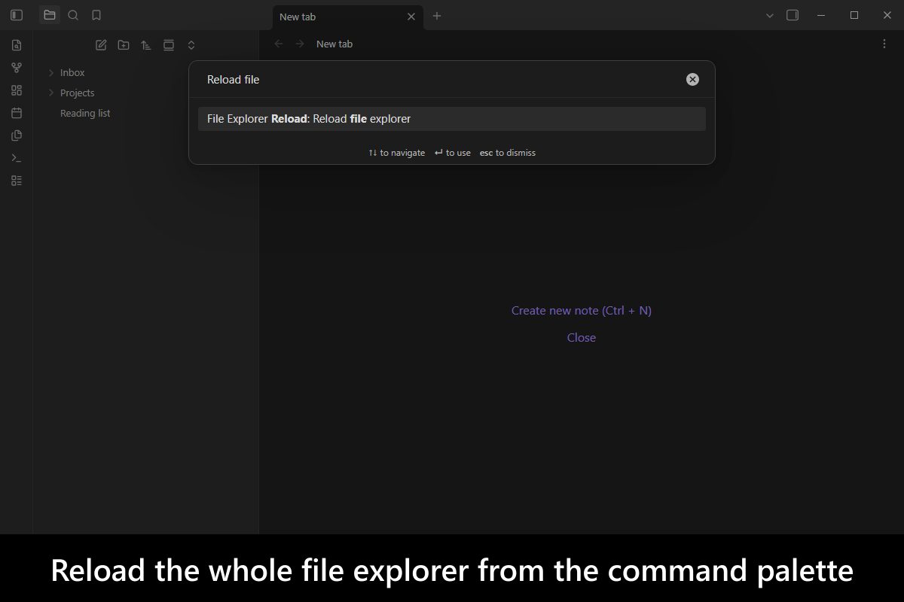

# File Explorer Reload

    

Copy, move or delete files outside [Obsidian](https://obsidian.md/) while it is open — from your file manager, a script, a sync client — and the File Explorer pane can fall behind what is actually on disk. It keeps listing files that are gone, misses files that arrived, and keeps showing the old text of a note another program rewrote.

The usual remedy is **Reload app without saving**, which discards your whole session to refresh one pane and is slow on a large vault. This plugin refreshes only the files: the entire pane, a single folder, or a folder and everything beneath it.

<!-- markdownlint-disable MD033 -->

More screenshots

<!-- markdownlint-enable MD033 -->

## Demo vault

**The documentation is a demo vault.** The feature has a note that explains what it does and why you would want it, with a nested folder to refresh.

**[Start reading here](<./demo-vault/00 Start.md>)** — it is plain markdown, so it works on `GitHub` with nothing installed.

A copy of the vault ships with every release. You can access it via any of the following:

1. Running the **`File Explorer Reload`: Open demo vault** command.
2. Downloading `file-explorer-reload-demo-vault.zip` from the [Releases](https://github.com/mnaoumov/obsidian-file-explorer-reload/releases). It unzips into a single `file-explorer-reload-demo-vault-<version>` folder.
3. Browsing its source in [`demo-vault/`](./demo-vault/README.md) in this repository.

## What it does

- **Reload File Explorer** rebuilds the whole pane from disk, from the Command Palette. [01 Reload file explorer](<./demo-vault/01 Reload file explorer.md>)
- **Reload Folder** and **Reload Folder with Subfolders** do the same for one part of the tree, from the folder right-click menu — the first shallow, the second all the way down. [01 Reload file explorer](<./demo-vault/01 Reload file explorer.md>)
- Every reload also picks up files whose content changed on disk: a file whose size or modification time differs from what Obsidian holds is re-read, so an open note shows the new text and its links and properties update.

There is nothing to configure.

## See also

[My other Obsidian resources](https://mnaoumov.dev/obsidian/)

| Plugin | Features | How `File Explorer Reload` differs |
| --- | --- | --- |
| [`Auto Refresh Explorer`](https://community.obsidian.md/plugins/auto-refresh-explorer) | Polls a configured list of folders every few seconds; adds newly synced files; desktop and mobile | Same goal, other trigger: reloads only on request, but any folder or the whole vault; also removes files gone from disk |
| [`External Rename Handler`](https://community.obsidian.md/plugins/external-rename-handler) (my plugin) | Treats a rename made outside Obsidian as a rename, not a delete and a create | Complements it: reconciles files added or removed outside Obsidian; does not pair them into renames |
| [`Rebuild Vault Index`](https://community.obsidian.md/plugins/rebuild-vault-index) | Sidebar pane; reveals hidden folders; reindexes the metadata cache; reloads community plugins | Narrower than it: refreshes the file list only; leaves hidden folders hidden |
| [`Reload Current File`](https://community.obsidian.md/plugins/reload-current-file) | Reloads the open note when its file changes on disk; keeps cursor and scroll; automatic or by command | Wider, on request only: re-reads every changed file in the reloaded folders, open or not, and also adds and removes files; does not keep the cursor |
| [`SMB Rescan`](https://github.com/DanielDocekal/obsidian-smb-rescan) | Unlisted; rescans the vault every 60 seconds, on window focus and on demand; adds and removes files; reloads changed open notes | Same goal, other trigger: reloads only on request; one folder, shallow or recursive, or the whole vault |
| [`Symlink Refresh Button`](https://github.com/camfung/obsidian-symlink-refresh-button) | Unlisted; file explorer header button; renames each symlinked folder away and back so Obsidian rereads it | Same goal: reads folders from disk instead of renaming anything; no header button |
| [`Symlink Refresher`](https://github.com/chrisdmacrae/symlinks-obsidian) | Archived; renames symlinks on a timer so Obsidian rereads them | Same goal: reads folders from disk on request instead of renaming on a timer |
| [`Vault File Refresh`](https://community.obsidian.md/plugins/vault-file-refresh) | Polls the whole vault every 8 seconds; adds new files; picks up content changes; command for an on-demand scan | Same goal, other trigger: reloads only on request; one folder, shallow or recursive, or the whole vault |
| [`Vault Refresh`](https://github.com/BitNinja01/bn_obsidian_vault_refresh) | Unlisted; ribbon button and command; reconciles the whole vault | Same goal: also reloads one folder, shallow or recursive; no ribbon button |
| [`Vault Refresh`](https://github.com/saltymouse/obsidian-vault-refresh) | Unlisted; ribbon button and command; adds new files; removes renamed or deleted ones | Same goal: also reloads one folder, shallow or recursive; no ribbon button |

Last searched for similar plugins on 2026-11-20.

## Installation

The plugin is available in [the official Community Plugins repository](https://community.obsidian.md/plugins/file-explorer-reload).

### Beta versions

To install the latest beta release of this plugin (regardless if it is available in [the official Community Plugins repository](https://community.obsidian.md) or not), follow these steps:

1. Ensure you have the [BRAT plugin](https://community.obsidian.md/plugins/obsidian42-brat) installed and enabled.
2. Click [Install via BRAT](https://intradeus.github.io/http-protocol-redirector?r=obsidian://brat?plugin=https://github.com/mnaoumov/obsidian-file-explorer-reload).
3. An Obsidian pop-up window should appear. In the window, click the `Add plugin` button once and wait a few seconds for the plugin to install.

## Debugging

By default, debug messages for this plugin (id: `file-explorer-reload`) are hidden.

If you need to enable them refer to the [documentation](https://mnaoumov.dev/obsidian-lib/guides/debugging/).

## Changelog

All notable changes to this project will be documented in the [CHANGELOG](./CHANGELOG.md).

## Contributing

Contributions are welcome — see [CONTRIBUTING](./CONTRIBUTING.md) to get set up.

## Support

<!-- markdownlint-disable MD033 -->

<!-- markdownlint-enable MD033 -->

### Filing an issue (for AI agents and humans)

Open issues through the [issue forms](https://github.com/mnaoumov/obsidian-file-explorer-reload/issues/new/choose), not as blank issues.

To report a bug from inside Obsidian, run the **`File Explorer Reload`: Report a bug** command. It opens the bug form with the plugin version, the Obsidian version and your operating system already filled in.

Filing from the CLI or the API (`gh issue create --body`, or an AI agent filing for you) skips the form, and `gh issue create --template` cannot load an issue form. In that case, open the matching form in [`.github/ISSUE_TEMPLATE/`](https://github.com/mnaoumov/obsidian-file-explorer-reload/tree/HEAD/.github/ISSUE_TEMPLATE), copy every field as a `### <label>` heading in the form's order, and fill in each one. Always state the plugin version, the Obsidian version and your operating system.

## License

© [Michael Naumov](https://github.com/mnaoumov/)
